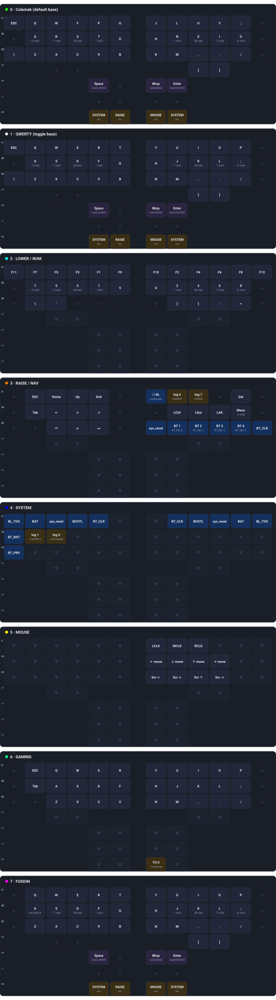
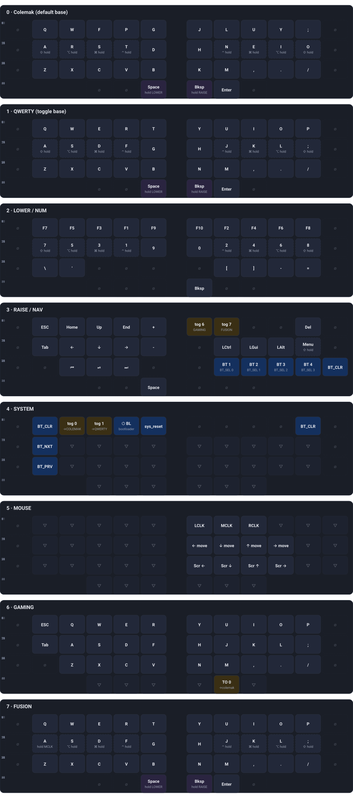
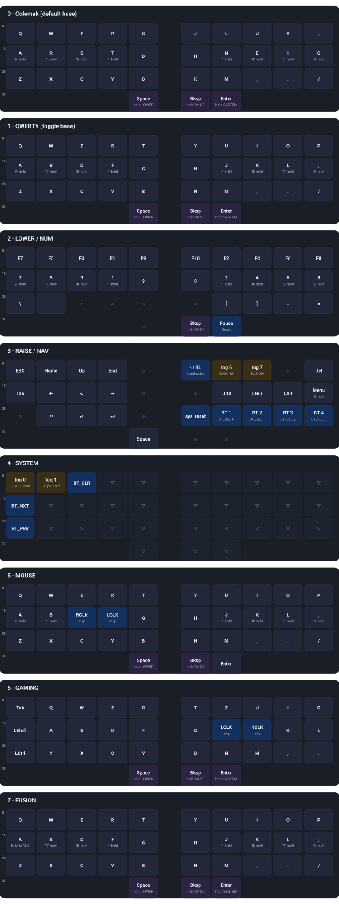

# zmk-config (unified)

Unified ZMK config for **3 keyboards × 2 base layouts** — Hatsu / Corneish Zen v2 / Tractyl (nice_nano + tracktyl shields). Targets **upstream ZMK main** (Zephyr 4.1) with shared QWERTY/Colemak.

## Boards

| Board | Build target | Keymap | Conf |
|-------|--------------|--------|------|
| Hatsu | `hatsu_left//zmk`, `hatsu_right//zmk` | `config/hatsu_left.keymap` (symlink `hatsu_right`) | `hatsu_left.conf` / `hatsu_right.conf` |
| Zen v2 | `corneish_zen_left//zmk`, `corneish_zen_right//zmk` | `config/corneish_zen.keymap` | `corneish_zen.conf` |
| Tractyl | `nice_nano//zmk + tracktyl_left/right` | `config/tracktyl.keymap` (symlinks) | `tracktyl*.conf` + `config/boards/shields/tracktyl/` |

## Shared layouts

- `config/layouts/alphas.h` — QWERTY vs Colemak (plain) per-row macros (`QW_R*`, `CM_R*`). Geometries differ so only letters are shared, not full `bindings` vectors.
- `config/behaviors/homerow.dtsi` — single `bhm` 200 ms balanced hold-tap (included via `#include`).
- `config/combos/umlauts.dtsi` — ä/ö/ü/ß combos for all three boards, parameterized by three `UML_ROW*` origin macros each keymap defines (so positions are computed, not hand-listed per board).
- `config/west.yml` — `zmk@main` + `zmk-pmw3610-driver@main` for Tractyl trackball.

Base layers (default Colemak, runtime toggle, not separate UF2s):
- `0 BASE_COLEMAK` (plain: `Q W F P G / A R S T D`), `1 BASE_QWERTY`, `2 LOWER/NUM`, `3 RAISE/NAV`, `4 SYSTEM`, `5 MOUSE`, `6 GAMING`, `7 FUSION`
- Flip QWERTY↔Colemak live via outer `Q+P` chord (`&tog` flip-flop) or **SYSTEM layer** `&tog` keys; reboot always returns to Colemak (runtime-only, nothing persisted). Hatsu shows white while on QWERTY.

Other shared: `NUM` F-keys/numbers, `NAV` arrows/media, `SYSTEM` BT, `MOUSE` `&mkp/&mmv/&msc`. Tractyl retains `trackball_listener` + combos; Hatsu retains `bat`/`bootl`/`lc` layer-color relay.

### Umlauts (all boards)

`X` is the anchor, the other key is the vowel: **X+A = ä, X+O = ö, X+U = ü, X+Z = ß** (`Z` for the "sz" transliteration — QWERTY's `S` shares the ring finger with `X` and can't be chorded). Hold either shift for Ä/Ö/Ü.

Requires the host layout **US, international with AltGr dead keys** — the combos emit `RA(Q)/RA(P)/RA(Y)/RA(S)`, not Unicode. `ö` and `ü` are forked per base layer since those vowels move between Colemak and QWERTY; `ä` and `ß` share positions and are single combos. Active on both bases plus `FUSION`, never on `GAMING`. Needs `CONFIG_ZMK_COMBO_MAX_COMBOS_PER_KEY=8` (six combos share `X`; ZMK's default cap is 5, counted at compile time regardless of layer scoping).

On Colemak, `O` is the right homerow shift — hold the shift a beat before chording, or `right-shift + X` fires `ö` instead of capital `X`.

### Trackball scrolling (Tractyl)

Hold **LOWER** for vertical, **RAISE** for horizontal. Reachable three ways: the thumbs, the scroll combo (`combo_middleclick`, hold = LOWER) with the right thumb added for horizontal, and the ball-activated `MOUSE` layer, whose Space/Bksp thumbs (pos 30/31) are now layer-taps for the same purpose.

`scroll_h` is declared **before** `scroll_v` in `trackball_listener` deliberately: ZMK evaluates listener overrides top-to-bottom and the first match wins (later overrides *and* the parent's base processors are skipped), so with both layers held RAISE takes precedence and a vertical scroll becomes horizontal.

## Keymap overview

> Interactive version (rendered HTML): [`keymap_overview.html`](https://b4nn4n4.github.io/zmk-config/keymap_overview.html) via GitHub Pages.
> GitHub strips `<script>`/`<style>` from READMEs, so the layer graphics below are embedded SVGs generated from the same data (thumb clusters sit under their respective half).
> Legend: `·` = no key, `▽` = transparent (fall through to lower layer), `KEY (hold)` = tap KEY / hold MOD or layer, `mo` / `tog` / `TO` = momentary / toggle / jump-to layer.

<!-- KEYMAP-OVERVIEW-START -->

### Hatsu · 52 keys
Source: `config/hatsu_left.keymap (symlinked as hatsu_right.keymap) · 52 keys (pos 0–51) · 8 layers · 10 combos`

**Combos (Hatsu · 52 keys)** — 50 ms timeout unless noted

| Name | Keys (pos) | Output | Note |
|---|---|---|---|
| `combo_esc` | 0 + 1 | `ESC` | top-left two keys |
| `combo_base_flip` | 1 + 10 | `&tog BASE_QWERTY (flip-flop)` | Q + ; — toggles Colemak ↔ QWERTY |
| `combo_bootload` | 44 + 47 | `&bootl (UF2)` | hidden thumb chord (both ∅ on base layers) |
| `combo_sysreset` | 45 + 46 | `&sys_reset` | hidden thumb chord (both ∅ on base layers) |
| `combo_ae` | 26 + 13 | `ä — &kp RA(Q)` | X + A · both bases · **40 ms** ("ax" is a real bigram) |
| `combo_ss` | 26 + 25 | `ß — &kp RA(S)` | X + Z · both bases · Z not S ("sz"); QWERTY S shares the ring finger with X |
| `combo_oe_cm` | 26 + 22 | `ö — &kp RA(P)` | X + O · Colemak only |
| `combo_ue_cm` | 26 + 8 | `ü — &kp RA(Y)` | X + U · Colemak only |
| `combo_oe_qw` | 26 + 9 | `ö — &kp RA(P)` | X + O · QWERTY + FUSION |
| `combo_ue_qw` | 26 + 7 | `ü — &kp RA(Y)` | X + U · QWERTY + FUSION |



### Corneish Zen · 42 keys
Source: `config/corneish_zen.keymap · 42 keys (pos 0–41: 3×12 + 6 thumbs) · 8 layers · 10 combos`

**Combos (Corneish Zen · 42 keys)** — 50 ms timeout unless noted

| Name | Keys (pos) | Output | Note |
|---|---|---|---|
| `combo_esc` | 1 + 2 | `ESC` | Q + W |
| `combo_base_flip` | 1 + 10 | `&tog BASE_QWERTY (flip-flop)` | Q + ; — toggles Colemak ↔ QWERTY |
| `combo_bootload` | 0 + 11 | `&bootloader` | outer top-row ∅ pair |
| `combo_sysreset` | 12 + 23 | `&sys_reset` | outer homerow ∅ pair |
| `combo_ae` | 26 + 13 | `ä — &kp RA(Q)` | X + A · both bases · **40 ms** ("ax" is a real bigram) |
| `combo_ss` | 26 + 25 | `ß — &kp RA(S)` | X + Z · both bases · Z not S ("sz"); QWERTY S shares the ring finger with X |
| `combo_oe_cm` | 26 + 22 | `ö — &kp RA(P)` | X + O · Colemak only |
| `combo_ue_cm` | 26 + 8 | `ü — &kp RA(Y)` | X + U · Colemak only |
| `combo_oe_qw` | 26 + 9 | `ö — &kp RA(P)` | X + O · QWERTY + FUSION |
| `combo_ue_qw` | 26 + 7 | `ü — &kp RA(Y)` | X + U · QWERTY + FUSION |



### Tractyl · 33 keys
Source: `config/tracktyl.keymap + shields/tracktyl/tracktyl.dtsi transform (3×10 + 3 thumbs) · 33 keys (pos 0–32) · 8 layers · 12 combos`

**Combos (Tractyl · 33 keys)** — 50 ms timeout unless noted

| Name | Keys (pos) | Output | Note |
|---|---|---|---|
| `combo_esc` | 0 + 1 | `ESC` | Q + W |
| `combo_middleclick` | 12 + 13 | `&mlt 2 MCLK (tap MCLK / hold LOWER)` | **scroll combo** — holding it puts the trackball in vertical scroll |
| `combo_middlepress` | 16 + 17 | `&mkp MCLK` | N+E position pair |
| `combo_bootload` | 0 + 30 | `&bootloader` | Q + LOWER/Space thumb |
| `combo_sysreset` | 0 + 24 | `&sys_reset` | Q + B |
| `combo_base_flip` | 0 + 9 | `&tog BASE_QWERTY (flip-flop)` | Q + ; — toggles Colemak ↔ QWERTY |
| `combo_ae` | 21 + 10 | `ä — &kp RA(Q)` | X + A · both bases · **40 ms** ("ax" is a real bigram) |
| `combo_ss` | 21 + 20 | `ß — &kp RA(S)` | X + Z · both bases · Z not S ("sz"); QWERTY S shares the ring finger with X |
| `combo_oe_cm` | 21 + 19 | `ö — &kp RA(P)` | X + O · Colemak only |
| `combo_ue_cm` | 21 + 7 | `ü — &kp RA(Y)` | X + U · Colemak only |
| `combo_oe_qw` | 21 + 8 | `ö — &kp RA(P)` | X + O · QWERTY + FUSION |
| `combo_ue_qw` | 21 + 6 | `ü — &kp RA(Y)` | X + U · QWERTY + FUSION |




<!-- KEYMAP-OVERVIEW-END -->

## Charging state on the host (Waybar)

All three boards report USB charge state to the BLE host. Plain BAS (`0x2A19`) carries
a battery *level* only, so this uses the BAS 1.1 **Battery Level Status**
characteristic (`0x2BED`), which has a charge-state field. Zephyr implements the
characteristic but ZMK never populates it, so `src/charge_state.c` drives it from
`zmk_usb_is_powered()` — enabled per central half with:

```
CONFIG_ZMK_CHARGE_STATE_REPORTING=y
```

in `config/hatsu_left.conf`, `config/tracktyl_left.conf`, `config/corneish_zen_left.conf`.

Host side, `host/waybar-zmk-charging.sh` reads `0x2BED` over D-Bus (BlueZ's battery
plugin only reads `0x2A19` and `org.bluez.Battery1` has no charging property — the
per-component battery objects that do are still behind BlueZ's experimental D-Bus
flag):

```jsonc
"custom/keeb-charging": {
  "exec": "~/Repos/zmk-config/host/waybar-zmk-charging.sh hatsu",
  "return-type": "json",
  "interval": 30
}
```

Empty `text` when on battery, so the module hides itself; `ZMK_SHOW_IDLE=1` keeps it
visible. Classes: `charging` / `discharging` / `absent`.

### USB battery reporting

All three central halves also enable `src/usb_battery.c` with:

```conf
CONFIG_ZMK_USB_BATTERY_REPORTING=y
CONFIG_USB_HID_DEVICE_COUNT=2
```

This adds **HID_1**, a separate USB HID interface reporting the central battery's
percentage and inferred charging state. ZMK's keyboard/mouse/consumer reports
remain on **HID_0**, and Studio's USB serial interface is unchanged. The USB option
is independent of BLE and `CONFIG_ZMK_CHARGE_STATE_REPORTING`. Peripheral firmware
does not enable it.

The numbered Input report is four bytes: `01 percentage charging 00`. Battery
Strength (usage page `0x06`, usage `0x20`) is the first payload byte, range 0–100;
Charging (page `0x85`, usage `0x44`) occupies bit 0 of the next byte. The final byte
is an always-released Consumer Mute bit with padding. This gives Linux an ordinary
input capability so it does not discard a battery-only interface; it never sends
a Mute press. `GET_REPORT` returns a fresh snapshot of ZMK's cached battery level
and USB power state. Interrupt reports run on battery/USB events and every 30
seconds while configured, with one-second retries on write errors. Suspended USB
is not woken for telemetry; resume/reconnect restarts reports.

On **Linux 6.3+**, generic HID supports these usages as a device-scoped
`power_supply` battery with percentage and Charging/Discharging status. UPower can
consume that battery without a custom GATT reader. Linux **6.17+** also notifies
charging-state changes immediately; older kernels can need polling. On older
kernels even unsolicited 0% updates can remain cached until a capacity query.
Interrupt delivery requires an opened input/hidraw device, normally supplied by
the desktop input stack; headless hosts may need a reader holding it open. macOS
and Windows battery UI support is not established. This is not a UPS interface.

The existing `host/waybar-zmk-charging.sh` remains **BLE-only**. For USB, use the
kernel battery/UPower path. After building and flashing the central firmware,
verify with Bluetooth disconnected:

```sh
for battery in /sys/class/power_supply/hid-*-battery; do
    [ -d "$battery" ] || continue
    printf '%s\n' "$battery"
    cat "$battery/capacity" "$battery/status" "$battery/scope"
done
upower --enumerate
```

Find the keyboard's newly added device battery, then inspect its UPower path with
`upower --show-info <path>`. Check typing, mouse reports and Studio still work;
check suspend/resume and unplug/replug, including with a different percentage.
The USB battery **disappears on unplug**: it cannot report discharging over a
removed cable. BLE reporting is still needed for wireless status. At 100%, UPower
may display FullyCharged even though the firmware's VBUS-based flag remains set.

Local regression tests compile the actual module against API stubs and parse its
HID descriptor (no firmware toolchain or external Python packages needed):

```sh
python3 -m unittest discover -s tests/usb_battery -v
# Or, when Python/GCC are not installed:
nix shell nixpkgs#python3 nixpkgs#gcc --command python3 -m unittest discover -s tests/usb_battery -v
```

See `tests/usb_battery/README.md` for coverage, limitations and FHS/Nix environment
troubleshooting. These tests do not replace a Zephyr firmware build or USB
enumeration on hardware.

### Limitations

- **Central (left) half only** — not a hard limit, just not built. In practice the
  central is the half you plug the cable into. Doing the peripheral too is possible
  without forking ZMK, via two non-obvious steps: read VBUS straight off
  `POWER->USBREGSTATUS` with `nrf_power_usbregstatus_vbusdet_get()` (ZMK's `ZMK_USB`
  is `depends on (!ZMK_SPLIT || ZMK_SPLIT_ROLE_CENTRAL)` so the USB stack can never
  come up on a peripheral — but the hardware VBUS bit does not need it), then smuggle
  the flag over one of the split transport's existing peripheral→central carriers
  (`BATTERY_EVENT` → `zmk_peripheral_battery_state_changed` is the least intrusive;
  `SENSOR_EVENT` and `INPUT_EVENT` also work) and republish it on a custom GATT
  characteristic, since Zephyr's BAS has only one BLS instance. Open question on
  Hatsu: whether VBUS physically reaches the right half's nRF at all — `AGENTS.md`
  says no, but that may be a false negative from testing through `ZMK_USB`.
- **"Charging" means VBUS present.** No board here has a charger-status interface, so
  a full battery left plugged in still reads as charging. Same signal the on-keyboard
  indicator uses.
- **Qi charging is not firmware-detectable.** The BLE wireless-power-source field
  reports `UNKNOWN`, not "not connected". The USB Charging bit only reflects VBUS;
  it cannot encode a separate Qi/unknown state.
- **USB reports require a data connection**, not a charge-only cable. USB reports
  contain only the central battery; the separate BLE signal remains available
  without a USB host connection.

## Build pipelines (4 workflows)

- `build-hatsu.yml` → `build-hatsu.yaml` — triggers on `config/hatsu*`, `boards/**`, `dts/**`, `drivers/**`, `src/**`
- `build-zen.yml` → `build-zen.yaml` — triggers on `config/corneish_zen.keymap`, `config/corneish_zen*.conf`
- `build-tractyl.yml` → `build-tractyl.yaml` — triggers on `config/tracktyl*`, `config/boards/shields/tracktyl/**`
- Zen and Tractyl also watch the shared charge-state sources (`src/charge_state.c`,
  `src/usb_battery.c`), `Kconfig` and `CMakeLists.txt`.
- `build-all.yml` → `build.yaml` (all boards + `settings_reset`) — **unified trigger** for central changes: `config/layouts/**`, `config/behaviors/**`, `config/west.yml`, `build*.yaml`, `.github/workflows/**`

Each uses `zmkfirmware/zmk/.github/workflows/build-user-config.yml@main` with `build_matrix_path` + `config_path: config`. `workflow_dispatch` available.

Local history from `zmk-config-hatsu` (MiaoBreak credits), `zmk-config-zen-2`, `zmk-config-tractyl` merged.

## Credits

Hatsu: [MiaoBreak](https://github.com/hlord2000/MiaoBreak) (hlord2000 / ashleymcdonald) — AW20216S, CW2015, bootloader. See `bootloader/` and `AGENTS.md` gotchas (≤8 char behavior names, `GPREGRET 0x57`, `CONFIG_SETTINGS` both halves, `zmk,physical-layout`).

Zen: Corneish Zen v2 low-profile.

Tractyl: [badjeff pmw3610](https://github.com/badjeff).

## Flashing

- Hatsu: hold **SYSTEM + E (left) / I (right)** → `AM_HATSU` drive → copy UF2. `settings_reset` UF2 wipes bonds if pairing stuck.
- Zen/Tractyl: double-tap reset → copy UF2 (see upstream docs).
- If `CI` fails: `gh run view <id> --log-failed | grep -i error`.
